# Plano de Testes Funcionais — CriptoMarket

**Projeto:** CriptoMarket — Marketplace descentralizado na Ethereum

**Repositório:** EduardaSouzaDev/AP2-ODS3

**Ambiente:** Frontend HTML/CSS/JavaScript, Web3.js, MetaMask e Ethereum Sepolia

**Tipo de teste:** Funcional, integração, segurança de acesso, tratamento de erros e interface

**Responsável:** Oziel Bezerra de Lima

---

## 1. Objetivo

Este plano tem como objetivo verificar o funcionamento da aplicação descentralizada CriptoMarket, validando a integração entre a interface web, a carteira MetaMask e o contrato inteligente implantado na rede Ethereum Sepolia.

Os testes contemplam operações de compradores, vendedores e administradores, incluindo transações com ETH, gerenciamento de pedidos, controle de acesso, tratamento de erros e apresentação de informações da blockchain.

## 2. Ambiente e preparação

### Ferramentas

- Navegador com MetaMask instalada.
- Rede Ethereum Sepolia (Chain ID: `11155111`).
- Contas de teste com SepoliaETH.
- Sepolia Etherscan para consultar transações e eventos.
- Frontend executado localmente ou hospedado na Vercel.

### Contas utilizadas

| Identificação | Papel | Descrição |
|---|---|---|
| Conta A | Vendedor | Cadastro de produtos, envio e saque |
| Conta B | Comprador | Compras, recebimento e reembolso |
| Conta C | Administrador | Conta registrada como `dono` do contrato |

A conta C deve corresponder ao proprietário real do contrato. Uma das outras contas poderá desempenhar esse papel caso seja proprietária.

### Dados de teste

| Dado | Valor sugerido |
|---|---|
| Nome do produto | Produto QA |
| Preço | 0.0001 ETH |
| Estoque | 3 unidades |
| Código de rastreio | QA-TRACK-001 |
| Rede | Ethereum Sepolia |

Os valores podem ser adaptados conforme o saldo disponível e as restrições da aplicação.

---

# 3. Casos de teste

## CT-01 — Conexão com a MetaMask

**Objetivo:** Verificar se a aplicação permite conectar uma carteira Ethereum e apresenta corretamente as informações da conta.

**Prioridade:** Alta

**Pré-condições:**
- MetaMask instalada e desbloqueada.
- Frontend carregado no navegador.
- Uma conta disponível na carteira.

**Procedimento:**

1. Acessar a página inicial do CriptoMarket.
2. Localizar o botão **Conectar Carteira**.
3. Clicar no botão.
4. Selecionar uma conta na MetaMask.
5. Autorizar a conexão.
6. Observar o cabeçalho da aplicação.
7. Comparar o endereço exibido com os dados da MetaMask.

**Resultado esperado:**
- A MetaMask solicita autorização quando necessário.
- A aplicação reconhece a conta conectada.
- O endereço é apresentado corretamente.

**Status:** Aprovado

**Evidência:** `evidencias/CT01-conectar_conta.png` 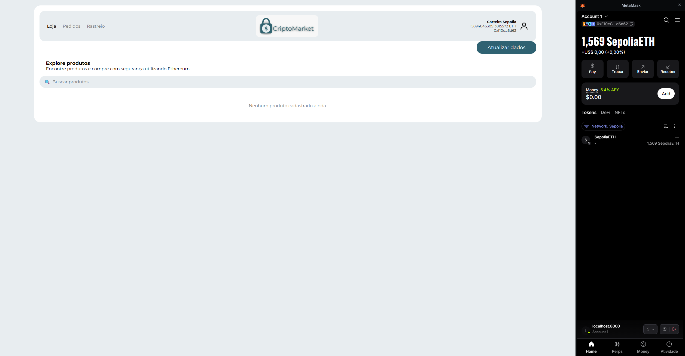

---

## CT-02 — Detecção e alteração da rede Ethereum

**Objetivo:** Verificar se a aplicação identifica uma rede incorreta e permite alternar para a Ethereum Sepolia.

**Prioridade:** Alta

**Pré-condições:**
- MetaMask instalada.
- Uma conta conectada.
- Uma rede diferente da Sepolia selecionada.

**Procedimento:**

1. Acessar a aplicação.
2. Selecionar outra rede Ethereum na MetaMask.
3. Verificar a mensagem apresentada pelo frontend.
4. Tentar iniciar uma operação que exija transação.
5. Clicar em **Trocar para Sepolia**.
6. Confirmar a alteração na MetaMask.
7. Verificar a atualização da aplicação.

**Resultado esperado:**
- A aplicação identifica a rede incorreta.
- Transações destinadas ao contrato Sepolia ficam bloqueadas.
- O frontend oferece a opção de trocar de rede.
- A MetaMask solicita a alteração para Sepolia.
- Após a troca, a aplicação atualiza os dados do contrato, incluindo o valor na carteira.

**Status:** Aprovado

**Evidência:** `evidencias/CT02-rede.png` 

---

## CT-03 — Cadastro de produto pelo vendedor

**Objetivo:** Verificar se um vendedor consegue cadastrar um produto por meio de uma transação blockchain.

**Prioridade:** Alta

**Pré-condições:**
- Conta A conectada na Sepolia.
- Saldo suficiente para pagar gas.
- Contrato não pausado.

**Procedimento:**

1. Conectar a conta A.
2. Clicar na conta e acessar a página como **Vendedor**.
3. Localizar o formulário de cadastro.
4. Informar o nome `Produto QA`.
5. Inserir o URL de uma imagem qualquer.
6. Informar preço de `0.0001 ETH`.
7. Informar estoque de `3` unidades.
8. Solicitar o cadastro.
9. Confirmar a transação na MetaMask.
10. Aguardar a confirmação.
11. Retornar à loja e localizar o produto.

**Resultado esperado:**
- A aplicação valida os campos obrigatórios.
- A MetaMask solicita a confirmação da transação.
- O frontend apresenta o hash e o status da operação.
- O produto passa a constar no catálogo.
- Os dados cadastrados correspondem aos valores informados.
- O evento `ProdutoCadastrado` pode ser identificado no registro da transação.

**Status:** Aprovado

**Evidência:** `evidencias/CT03-cadastro.png` 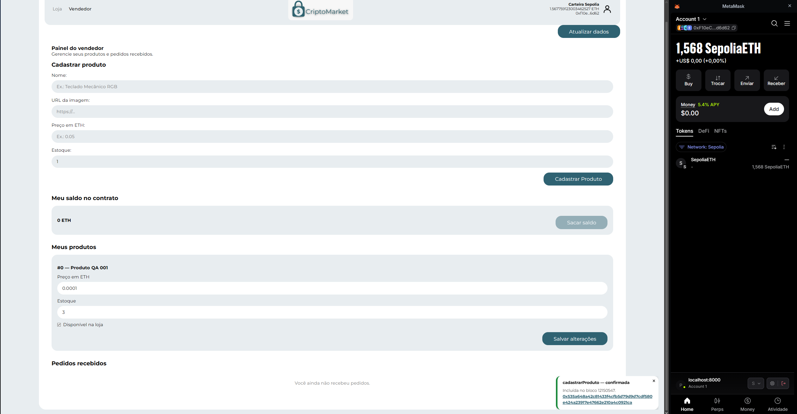

---

## CT-04 — Compra de produto utilizando ETH

**Objetivo:** Verificar a compra de uma unidade de produto com pagamento em SepoliaETH e criação de pedido.

**Prioridade:** Crítica

**Pré-condições:**
- Produto ativo cadastrado pela conta A.
- Estoque disponível.
- Conta B conectada.
- Saldo suficiente para preço e gas.
- Contrato não pausado.

**Procedimento:**

1. Conectar a conta B.
2. Acessar a loja.
3. Localizar `Produto QA`.
4. Conferir o preço e o estoque.
5. Clicar em **Comprar**.
6. Verificar o valor solicitado na MetaMask.
7. Confirmar a transação.
8. Aguardar a confirmação.
9. Acessar **Pedidos**.
10. Consultar a transação no Sepolia Etherscan.

**Resultado esperado:**
- A MetaMask solicita o valor correspondente ao preço de uma unidade.
- A transação é enviada e seu hash é apresentado.
- Após a confirmação, um pedido é criado.
- O pedido aparece com status **Pago**.
- O estoque disponível diminui em uma unidade.
- O pagamento permanece em custódia no contrato.
- O evento `PedidoCriado` é emitido.

**Status:** Aprovado

**Evidência:** `evidencias/CT04-compra.png` 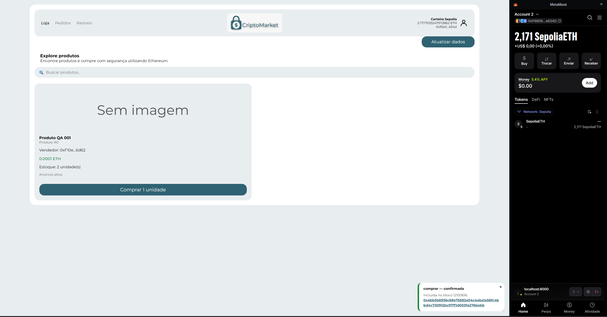

---

## CT-05 — Registro de envio do pedido

**Objetivo:** Verificar se o vendedor consegue registrar o envio de um pedido pago.

**Prioridade:** Alta

**Pré-condições:**
- Pedido existente com status Pago.
- Conta A correspondente ao vendedor do produto.
- Conta A conectada na Sepolia.

**Procedimento:**

1. Conectar a conta A.
2. Acessar a área **Vendedor**.
3. Localizar o pedido realizado pela conta B.
4. Selecionar a opção de registrar envio.
5. Informar `QA-TRACK-001` como código de rastreio.
6. Confirmar a transação na MetaMask.
7. Aguardar a confirmação.
8. Consultar o pedido na página de rastreio.

**Resultado esperado:**
- Somente o vendedor autorizado consegue registrar o envio.
- O código de rastreio é associado ao pedido.
- O status é alterado de **Pago** para **Enviado**.
- O evento `PedidoEnviado` é emitido.
- A informação aparece na área de rastreio.

**Status:** Aprovado

**Evidência:** `evidencias/CT05-envio.png` 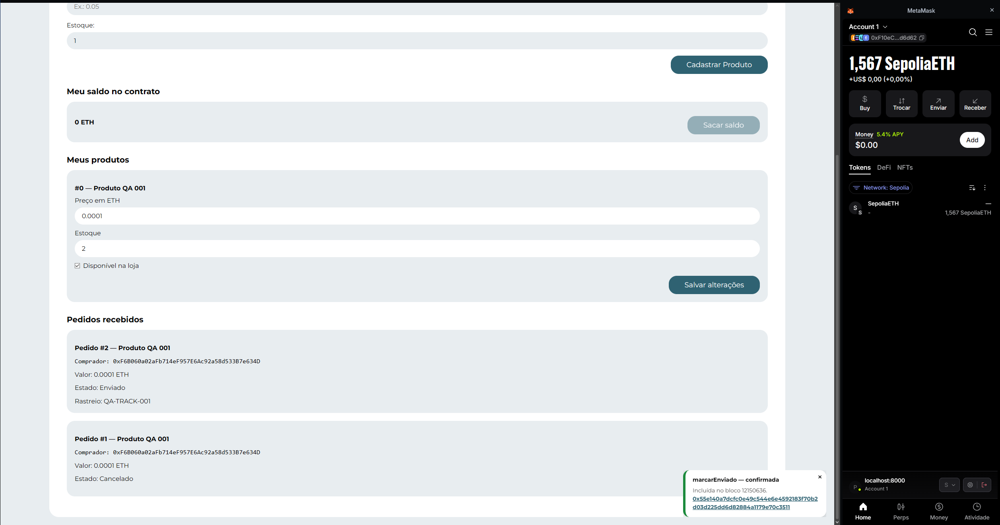

---

## CT-06 — Confirmação de recebimento pelo comprador

**Objetivo:** Verificar se o comprador consegue confirmar o recebimento de um pedido enviado, liberando o crédito do vendedor.

**Prioridade:** Crítica

**Pré-condições:**
- Pedido com status Enviado.
- Conta B identificada como compradora.
- Conta B conectada na Sepolia.

**Procedimento:**

1. Conectar a conta B.
2. Acessar **Pedidos**.
3. Localizar o pedido enviado.
4. Selecionar a opção de confirmar recebimento.
5. Confirmar a transação na MetaMask.
6. Aguardar a confirmação.
7. Consultar o novo status.
8. Verificar o crédito disponível para o vendedor.

**Resultado esperado:**
- A confirmação é permitida à conta compradora.
- O pedido passa para **Entregue**.
- O ETH deixa de estar retido em custódia para esse pedido.
- O valor líquido é creditado ao saldo sacável do vendedor.
- A taxa da plataforma é contabilizada conforme o contrato.
- O evento `EntregaConfirmada` é emitido.

**Status:** Aprovado

**Evidência:** `evidencias/CT06-entrega.png` 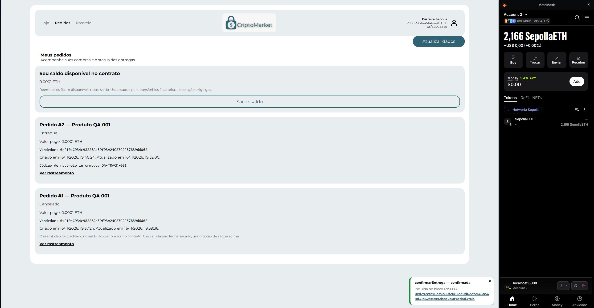

---

## CT-07 — Saque de saldo pelo vendedor

**Objetivo:** Verificar se o vendedor consegue transferir para sua carteira os valores disponibilizados após a entrega.

**Prioridade:** Crítica

**Pré-condições:**
- Pedido entregue.
- Conta A com crédito disponível no contrato.
- Conta A conectada e com ETH suficiente para gas.

**Procedimento:**

1. Conectar a conta A.
2. Acessar **Vendedor**.
3. Consultar o saldo disponível para saque.
4. Registrar o valor apresentado.
5. Clicar em **Sacar saldo**.
6. Confirmar a transação.
7. Aguardar a confirmação.
8. Consultar novamente o saldo sacável.
9. Verificar o saldo da MetaMask e a transação no Etherscan.

**Resultado esperado:**
- A aplicação permite solicitar o saque.
- A transação é confirmada.
- O saldo sacável é reduzido pelo valor retirado.
- A carteira recebe o ETH correspondente.
- A variação total do saldo da carteira considera também o gas pago.
- O evento `Saque` é emitido.

**Status:** Aprovado

**Evidência:** `evidencias/CT07-saque.png` 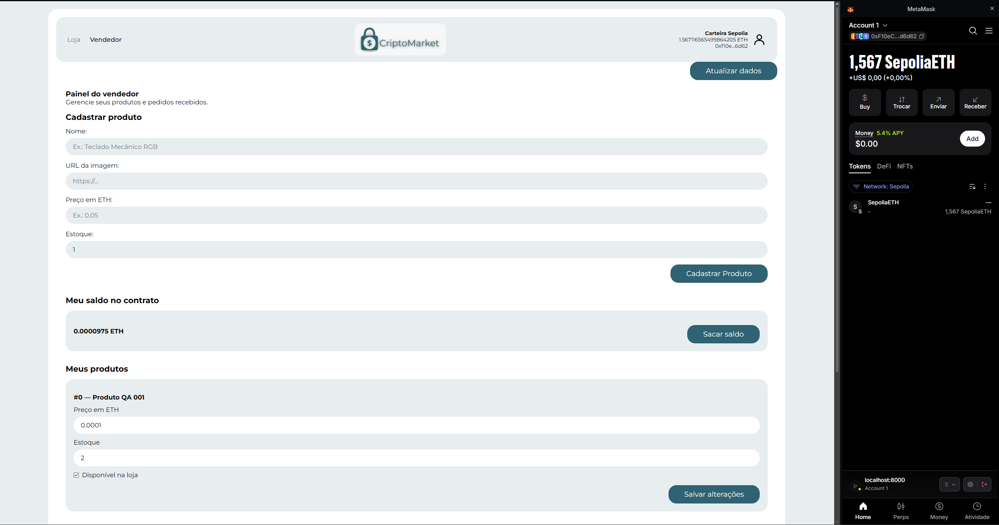

---

## CT-08 — Cancelamento de pedido e reembolso

**Objetivo:** Verificar se um pedido elegível pode ser cancelado e se o valor é disponibilizado para reembolso ao comprador.

**Prioridade:** Crítica

**Pré-condições:**
- Novo pedido com status Pago, ainda não enviado.
- Conta B identificada como compradora.
- Conta B conectada na Sepolia.

**Procedimento:**

1. Conectar a conta B.
2. Realizar uma nova compra.
3. Acessar **Pedidos**.
4. Localizar o pedido recém-criado.
5. Selecionar a opção de cancelamento.
6. Confirmar a transação na MetaMask.
7. Aguardar a confirmação.
8. Consultar o status e o saldo disponível para reembolso.
9. Utilizar **Sacar saldo** na página de Pedidos.
10. Consultar as duas transações no Etherscan.

**Resultado esperado:**
- O cancelamento é permitido enquanto o pedido estiver em estado elegível.
- O pedido passa para **Cancelado**.
- O valor correspondente é creditado ao saldo sacável do comprador.
- O saque transfere o reembolso para a carteira.
- Os eventos `PedidoCancelado` e `Saque` são registrados.
- A interface não apresenta o reembolso como transferido antes do saque.

**Resultado observado:** [Preencher]

**Status:** Não executado

**Hashes:** [Preencher]

**Evidência:** `evidencias/CT08-reembolso.png` 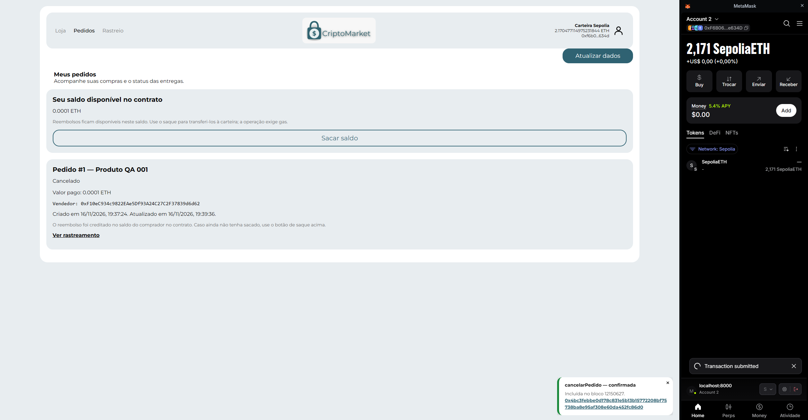

---

## CT-09 — Controle de acesso administrativo

**Objetivo:** Verificar se as funcionalidades administrativas estão disponíveis exclusivamente ao proprietário do contrato.

**Prioridade:** Crítica

**Pré-condições:**
- Conta B não proprietária.
- Conta C correspondente ao endereço retornado por `dono()`.
- Contrato acessível na Sepolia.

**Procedimento:**

1. Conectar a conta B.
2. Abrir o menu da carteira.
3. Verificar se a opção **Admin** está disponível.
4. Tentar acessar diretamente `admin.html`.
5. Observar o comportamento da interface.
6. Trocar para a conta C.
7. Acessar novamente a aplicação.
8. Abrir a página administrativa.
9. Verificar a disponibilidade das funcionalidades.

**Resultado esperado:**
- A conta B não recebe acesso às operações administrativas.
- O acesso direto à página não concede privilégios.
- O contrato impede transações administrativas de contas não autorizadas.
- A conta C é reconhecida como proprietária.
- As funcionalidades administrativas ficam disponíveis para C.

**Status:** Aprovado

**Evidência:** `evidencias/CT09-admin.png` 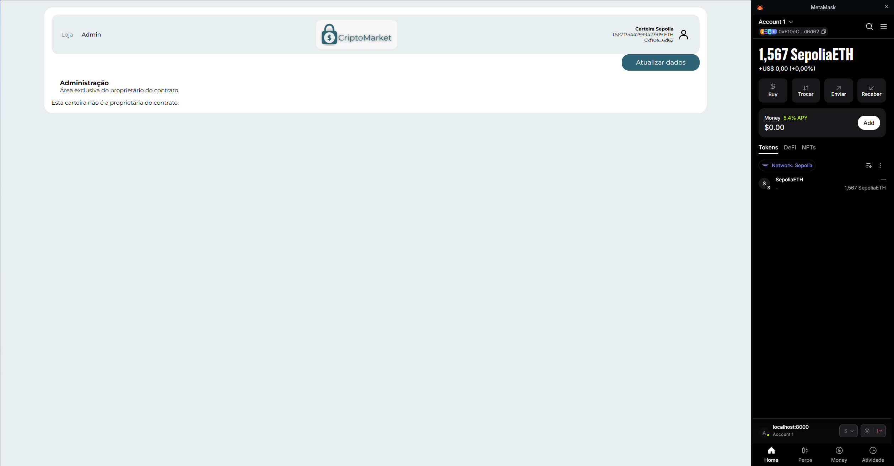

---

## CT-10 — Pausa e retomada do contrato

**Objetivo:** Verificar se o administrador consegue suspender temporariamente novas compras e cadastros e posteriormente retomar a operação.

**Prioridade:** Alta

**Pré-condições:**
- Conta C conectada.
- Contrato inicialmente não pausado.
- Produto ativo disponível para compra.

**Procedimento:**

1. Conectar a conta C.
2. Acessar **Admin**.
3. Selecionar a opção de pausar o contrato.
4. Confirmar a transação.
5. Verificar o estado de pausa.
6. Trocar para a conta B.
7. Tentar realizar uma nova compra.
8. Verificar o bloqueio da operação.
9. Trocar para a conta A e verificar o bloqueio de novos cadastros.
10. Retornar à conta C.
11. Retomar o contrato.
12. Confirmar que novas operações voltaram a ficar disponíveis.

**Resultado esperado:**
- Somente o administrador pode pausar ou retomar.
- O estado de pausa é atualizado após confirmação.
- Novas compras e cadastros ficam bloqueados durante a pausa.
- A aplicação apresenta uma mensagem adequada.
- A retomada restabelece as operações.
- O evento `PausaAlterada` é emitido.

**Status:** Não executado

**Evidência:** salvar em `evidencias/CT10-pausa.[png ou mp4]`

---

## CT-11 — Rejeição de transação na MetaMask

**Objetivo:** Verificar se a aplicação trata corretamente uma transação rejeitada pelo usuário.

**Prioridade:** Alta

**Pré-condições:**
- Conta A conectada na Sepolia.
- Operação válida disponível para execução.

**Procedimento:**

1. Acessar a área de vendedor.
2. Preencher um cadastro válido de produto.
3. Solicitar o envio da transação.
4. Aguardar a janela da MetaMask.
5. Selecionar **Rejeitar** ou **Cancelar**.
6. Observar a mensagem apresentada.
7. Consultar a listagem de produtos.
8. Verificar se a aplicação permite tentar novamente.

**Resultado esperado:**
- A operação é cancelada sem sucesso falso.
- A aplicação apresenta mensagem compreensível de rejeição.
- Nenhum novo produto é registrado pela operação rejeitada.
- O frontend permanece utilizável.
- Uma nova tentativa pode ser realizada.

**Status:** Aprovado

**Evidência:** `evidencias/CT11-rejeicao.png` 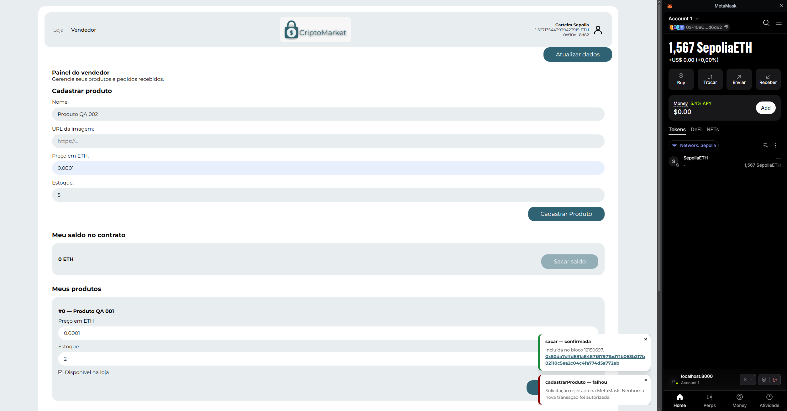

---

## CT-12 — Atualização após troca de conta ou rede

**Objetivo:** Verificar se a aplicação reage corretamente às mudanças de conta e rede realizadas na MetaMask.

**Prioridade:** Alta

**Pré-condições:**
- Contas A e B autorizadas no site.
- Aplicação carregada com a conta A.
- MetaMask instalada.

**Procedimento:**

1. Conectar a conta A.
2. Registrar o endereço e saldo apresentados.
3. Trocar para a conta B na MetaMask.
4. Verificar a atualização do cabeçalho.
5. Verificar as informações e permissões associadas à nova conta.
6. Trocar para uma rede diferente da Sepolia.
7. Verificar o bloqueio de operações incompatíveis.
8. Retornar à Sepolia.
9. Conferir se os dados foram atualizados.

**Resultado esperado:**
- O endereço exibido muda para a conta B.
- O saldo corresponde à nova conta.
- Os pedidos e créditos apresentados correspondem ao endereço ativo.
- Permissões administrativas são atualizadas.
- A troca de rede é detectada.
- Transações na rede incorreta ficam bloqueadas.
- Ao retornar à Sepolia, a aplicação atualiza seu estado.

**Status:** Aprovado

**Evidência:** `evidencias/CT12-troca.mp4` <video controls src="evidencias/CT12-troca.mp4" title="Title"></video>

---

## CT-13 — Consulta de eventos e histórico de transações

**Objetivo:** Verificar se a aplicação apresenta eventos relevantes do contrato e permite consultar suas transações no explorador.

**Prioridade:** Média

**Pré-condições:**
- Contrato implantado na Sepolia.
- Transações anteriores de cadastro, compra ou envio.
- Conexão com a rede disponível.

**Procedimento:**

1. Conectar uma conta autorizada.
2. Acessar as páginas de Pedidos ou Rastreio.
3. Consultar os eventos apresentados.
4. Localizar um evento associado a uma operação já executada.
5. Conferir seu tipo e identificadores.
6. Abrir o link da transação no Etherscan.
7. Comparar os dados com o registro on-chain.
8. Utilizar **Atualizar dados**, quando necessário.

**Resultado esperado:**
- Os eventos disponíveis dentro da janela consultada são apresentados corretamente.
- O tipo de evento corresponde à operação realizada.
- Os links direcionam para o Sepolia Etherscan.
- Os dados exibidos são consistentes com o contrato.
- Uma falha na consulta de eventos é informada sem apresentar registros inventados.

**Observação:** a integração atual consulta uma janela limitada de blocos. Eventos antigos podem não aparecer no histórico, mesmo que os pedidos continuem disponíveis no contrato.

**Status:** Aprovado

**Evidência:** `evidencias/CT13-eventos.png` 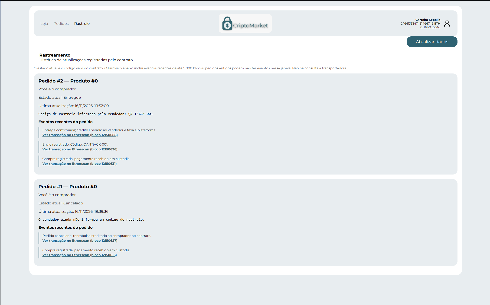

---

## CT-14 — Responsividade e usabilidade da interface

**Objetivo:** Verificar se a interface permanece utilizável em diferentes resoluções de tela.

**Prioridade:** Média

**Pré-condições:**
- Frontend acessível.
- Navegador com ferramentas de desenvolvedor.
- Páginas principais disponíveis.

**Procedimento:**

1. Abrir a aplicação no navegador.
2. Acessar as páginas Loja, Pedidos, Rastreio, Vendedor e Admin, conforme as permissões disponíveis.
3. Inspecionar a interface em resolução desktop de 1366 × 768.
4. Alterar para uma resolução de 768 × 1024.
5. Alterar para uma resolução de 390 × 844.
6. Verificar menus, botões, formulários, imagens e textos.
7. Testar a navegação entre páginas.
8. Verificar se os elementos permanecem acessíveis.
9. Observar se há rolagem horizontal inesperada ou sobreposição de componentes.

**Resultado esperado:**
- A interface se adapta às resoluções avaliadas.
- Botões e formulários permanecem utilizáveis.
- Não há sobreposição que impeça operações.
- Textos importantes permanecem legíveis.
- Imagens não ultrapassam indevidamente seus contêineres.
- A navegação continua funcional.

**Observação:** a versão móvel do CSS oculta a logo da navbar. Esse comportamento deve ser avaliado como decisão de interface, não automaticamente como defeito.

**Status:** Aprovado

**Evidência:** `evidencias/CT14-responsividade.png` 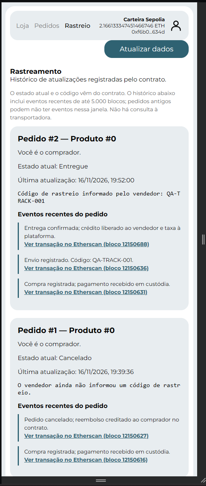

---

# 4. Registro de defeitos

Todo comportamento divergente do resultado esperado deverá ser registrado com as seguintes informações:

| Campo | Descrição |
|---|---|
| ID | Identificador do defeito, como BUG-001 |
| Caso relacionado | Identificador do teste que revelou o problema |
| Descrição | Comportamento incorreto identificado |
| Severidade | Crítica, Alta, Média ou Baixa |
| Passos para reproduzir | Sequência necessária para reproduzir o defeito |
| Resultado esperado | Comportamento definido no caso de teste |
| Resultado observado | Comportamento efetivamente identificado |
| Evidência | Captura, log ou hash da transação |
| Situação | Aberto, Em correção, Corrigido ou Reaberto |

# 5. Critérios de encerramento

A validação será considerada concluída quando:

1. Todos os casos planejados tiverem sido executados ou tiverem impedimentos documentados.
2. Os defeitos críticos identificados tiverem sido corrigidos e retestados.
3. As transações essenciais tiverem sido verificadas na Sepolia.
4. Os resultados e evidências estiverem registrados.
5. As limitações restantes estiverem descritas no relatório final.

# 6. Resultado consolidado

| Indicador | Quantidade |
|---|---|
| Casos planejados | 14 |
| Aprovados | 13 |
| Reprovados | 0 |
| Bloqueados | 0 |
| Não executados | 1 |

**Situação atual:** Nenhum bug detectado e a aplicação se comporta conforme esperado

**Parecer de QA:** Aprovado
